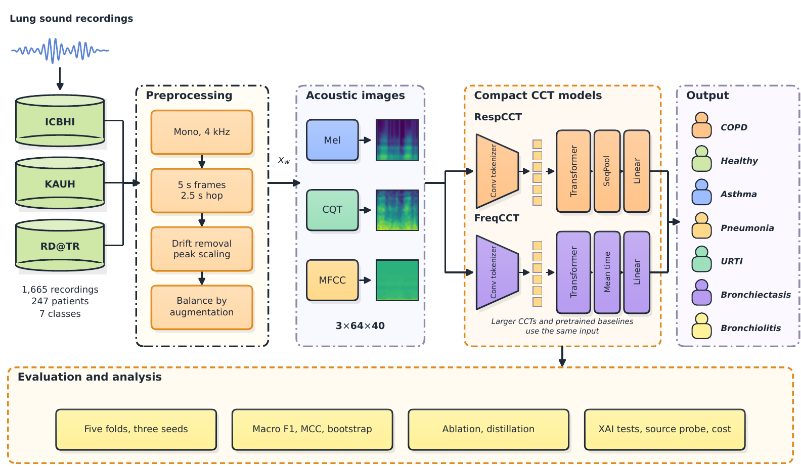

# RespCCT and FreqCCT

Code, configurations and results for *RespCCT and FreqCCT: Lightweight and Explainable Convolutional Transformers for Multi-Class Respiratory Disease Classification* (submitted to *Biomedical Signal Processing and Control*).

RespCCT and FreqCCT are compact convolutional transformers trained from random initialization on lung sounds. Audio files from three public databases (ICBHI, KAUH, RD@TR) are cut into 5 s frames, converted into a 3×64×40 stack of mel, constant-Q and MFCC images, and assigned to seven diagnostic classes.

| Model | Parameters | Macro F1, fold 0 | Macro F1, five folds | Weights (fp32) |
|---|---|---|---|---|
| RespCCT | 173,187 | 0.9695 | 0.9594 (three seeds) | 0.69 MB |
| FreqCCT | 124,999 | 0.9514 | 0.9408 (one seed) | 0.50 MB |

Folds were drawn at the frame level, so the scores describe new frames from the pooled cohort, not new patients. Trained weights are not released.

## Contents

| Path | Content |
|---|---|
| `notebooks/RespCCT_FreqCCT_full.ipynb` | all code in one notebook, outputs cleared |
| `notebooks/RespCCT_FreqCCT_full_with_outputs.ipynb` | the same notebook with the outputs of the reported runs |
| `code/` | `bspc_lib.py` (models, metrics, training) and `features.py` (audio to image stacks) |
| `configs/` | training recipes, view-fusion choice and run settings |
| `results/tables/`, `results/runs/` | result tables and per-run metrics, curves and configs |
| `results/figures/` | figures of the paper |
| `docs/` | methodology diagram and its editable sources |
| `paper/references.bib` | bibliography of the paper |

## Data

The recordings are public and are not redistributed here.

| Database | Source |
|---|---|
| ICBHI 2017 | https://bhichallenge.med.auth.gr/ICBHI_2017_Challenge |
| KAUH | Mendeley Data, doi:10.17632/jwyy9np4gv.3 |
| RD@TR | Mendeley Data, doi:10.17632/p9z4h98s6j.1 |

## Reproducing

1. Build a CSV with one row per audio file and the columns `original_filepath`, `source`, `unified_label`, `pkey`, `fold`.
2. Run `python code/features.py recordings.csv <Data>/SeedPaper_CCT/features`.
3. Run `notebooks/RespCCT_FreqCCT_full.ipynb` on Google Colab (T4 GPU for training, CPU for timing). Paths are set in the first cell of Part 1 and of Part 3.

Install the dependencies with `pip install -r requirements.txt`. Latency was measured on a shared cloud CPU, so compare ratios rather than milliseconds. The hash of `code/bspc_lib.py` is `425661e596`.

## Citation and license

See `CITATION.cff`. Released under the MIT License.
